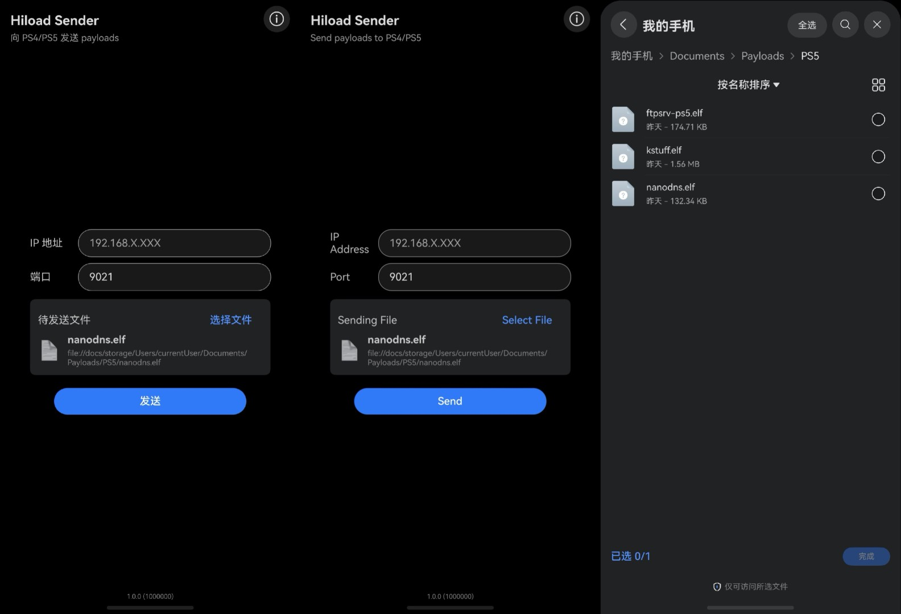

# Hiload Sender
PS4/5 payload sender for HarmonyOS (6.0+), supports `.elf, .bin, .js, .py` payloads.

Demo video on Mate 60 Pro (send to PS4 and PS5): [BV12AVC6TEZD](https://www.bilibili.com/video/BV12AVC6TEZD).

_Only tested on Mate 60 Pro._

## Screenshot

